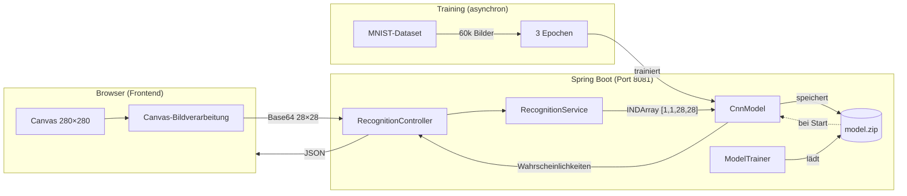
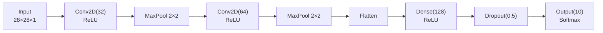
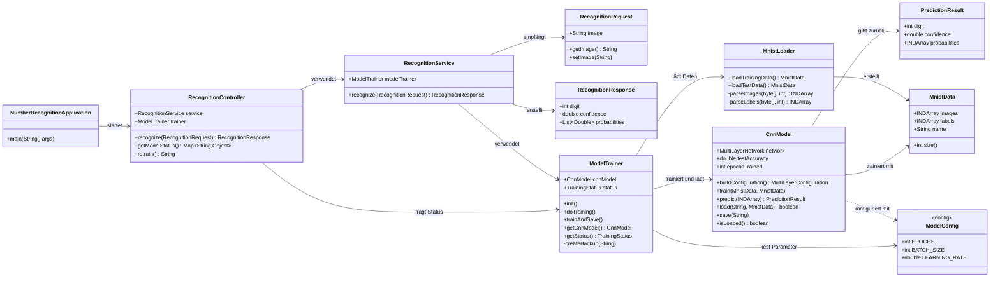

# Ziffernerkennung mit Java

Spring Boot Anwendung, die Ziffern (0–9) mit einem Convolutional Neural Network (CNN) erkennt. Das Modell wird in Java mit Deeplearning4j trainiert und über eine REST API deployed. Ein Web-Frontend ermöglicht das Zeichnen mit der Maus.

## Architektur

### Systemdatenfluss



### CNN-Architektur



**CNN-Layer im Detail:**

```
Input (28×28) → Conv2D(32) → MaxPool → Conv2D(64) → MaxPool → Dense(128) → Dropout(0.5) → Output(10, Softmax)
```

## Schnellstart

### Lokal starten

```bash
mvn spring-boot:run
```

Beim ersten Start wird das Modell automatisch mit dem MNIST-Datensatz trainiert (~3-5 Minuten, 3 Epochen). Das Training läuft asynchron im Hintergrund, der Webserver ist sofort verfügbar. Danach wird das trainierte Modell aus `model.zip` geladen.

### Docker

```bash
docker build -t number-recognition .
docker run -p 8081:8081 number-recognition
```

## Web-Frontend

Öffne `http://localhost:8081` im Browser:

1. Zeichne eine Ziffer (0–9) auf dem Canvas
2. Klicke auf "Erkennen"
3. Das CNN erkennt die Ziffer und zeigt Konfidenz + Wahrscheinlichkeiten an

## API-Endpunkte

| Endpunkt | Methode | Beschreibung |
|----------|---------|-------------|
| `/api/recognize` | POST | Ziffer erkennen (Base64-Bild) |
| `/api/model/status` | GET | Trainingsstatus und Modell-Informationen |
| `/api/train` | POST | Training neu starten |

### Beispiel: Erkennung

```bash
curl -X POST http://localhost:8081/api/recognize \
  -H "Content-Type: application/json" \
  -d '{"base64": "BASE64_ENCODED_28x28_IMAGE"}'
```

Antwort:

```json
{
  "digit": 7,
  "confidence": 0.9823,
  "probabilities": [0.0001, 0.0005, 0.0002, 0.0001, 0.0003, 0.0002, 0.0001, 0.9823, 0.0001, 0.0001]
}
```

Die `probabilities`-Liste enthält die Wahrscheinlichkeiten für die Ziffern 0–9 in Reihenfolge (Index 0 = Ziffer 0, Index 1 = Ziffer 1, usw.).

### Beispiel: Modell-Status

```bash
curl http://localhost:8081/api/model/status
```

Antwort:

```json
{
  "ready": true,
  "status": "READY",
  "accuracy": 98.63,
  "epochsTrained": 3,
  "modelLoaded": true
}
```

## CNN-Training

Das Modell wird beim ersten Start automatisch trainiert:

- **Datensatz:** MNIST (60.000 Trainings-, 10.000 Test-Bilder)
- **Epochen:** 3
- **Batch Size:** 256
- **Learning Rate:** 0.001 (Adam-Optimizer)
- **Erreichte Accuracy:** ~98.63%

Das Training läuft asynchron im Hintergrund — der Webserver ist sofort verfügbar. Der Status kann über `/api/model/status` abgefragt werden. Das trainierte Modell wird als `model.zip` gespeichert und beim nächsten Start in wenigen Sekunden geladen.

**Automatische Backups:** Nach jedem Training werden automatisch Backups auf Desktop und Documents erstellt.

## Tests

Das Projekt enthält **37 JUnit 5-Tests** in **7 Test-Klassen**, die die Kernkomponenten abdecken:

| Test-Klasse | Tests | Abgedeckte Funktionalität |
|-------------|-------|---------------------------|
| `ModelConfigTest` | 7 | Bildabmessungen, Trainingsparameter, CNN-Architektur, Modell-Dateiname |
| `PredictionResultTest` | 3 | Konstruktor, Getter, Wahrscheinlichkeitssumme |
| `MnistDataTest` | 5 | Daten-Container, Image-Shape, Label-Shape, toString |
| `MnistLoaderTest` | 3 | Pixel-Normalisierung, One-Hot-Encoding, `& 0xFF` unsigned byte Maskierung |
| `CnnModelTest` | 11 | Architektur-Konfiguration, Vorhersage, Speichern/Laden, Fehlerbehandlung |
| `RecognitionServiceTest` | 4 | Gültige Erkennung, leeres Base64, falsche Bildgröße, Wahrscheinlichkeitssumme |
| `RecognitionControllerTest` | 4 | REST-Endpunkte `/recognize`, `/model/status` |

**Kritische Tests:**
- `MnistLoaderTest.unsignedByteMasking` — sichert ab, dass Pixelwerte > 127 nicht negativ werden (`& 0xFF` Bug)
- `CnnModelTest.save_and_load_restoresModel` — sichert ab, dass Speichern und Laden das Modell intakt lässt
- `RecognitionServiceTest.recognize_emptyBase64` — sichert ab, dass leere Bilder eine klare Fehlermeldung produzieren

**Tests ausführen:**

```bash
mvn test
```

Ergebnis: 37 Tests, 0 Failures, 0 Errors, 0 Skipped — BUILD SUCCESS

**Hinweis:** Da Java 25 Mockito Inline-Mocking blockiert, verwenden `RecognitionServiceTest` und `RecognitionControllerTest` echte CNN-Objekte statt Mocks. `MnistLoaderTest` verwendet synthetische IDX-Daten (kein Internet nötig).

## Projektstruktur

### Verzeichnisbaum

```
src/main/java/com/numbrecognition/
├── NumberRecognitionApplication.java  # Spring Boot Entry Point
├── config/
│   └── ModelConfig.java                    # Hyperparameter
├── data/
│   ├── MnistLoader.java                    # MNIST-Datensatz laden
│   └── MnistData.java                      # Datenklasse
├── model/
│   ├── CnnModel.java                       # CNN-Architektur, Training, Inferenz
│   └── PredictionResult.java               # Erkennungsergebnis
├── dto/
│   ├── RecognitionRequest.java             # API-Anfrage
│   └── RecognitionResponse.java            # API-Antwort
├── service/
│   ├── ModelTrainer.java                   # Automatisches Training
│   └── RecognitionService.java             # Bildvorverarbeitung
└── controller/
    └── RecognitionController.java          # REST-Endpunkte

src/test/java/com/numbrecognition/
├── config/
│   └── ModelConfigTest.java               # 7 Tests: Konfigurationswerte
├── data/
│   ├── MnistDataTest.java                 # 5 Tests: Daten-Container
│   └── MnistLoaderTest.java               # 3 Tests: Pixel-Normalisierung, One-Hot, & 0xFF
├── model/
│   └── CnnModelTest.java                  # 11 Tests: Architektur, Speichern/Laden
├── service/
│   └── RecognitionServiceTest.java        # 4 Tests: Erkennung, Fehlerbehandlung
└── controller/
    └── RecognitionControllerTest.java     # 4 Tests: REST-Endpunkte
```

### Klassendiagramm



## Technologien

| Technologie | Version | Verwendung |
|-------------|---------|-----------|
| Spring Boot | 3.4.x | REST API, Actuator |
| Deeplearning4j | 1.0.0-M3.1 | CNN-Training und Inferenz |
| ND4J | 1.0.0-M3.1 | Numerische Arrays |
| JUnit 5 | 5.10.x | Unit-Tests (37 Tests) |
| Java | 25 | Sprache |
| Docker | — | Containerisierung |

## Lessons Learned

- **CNN vs. simples neuronales Netz:** CNN erreicht ~99% Accuracy, ein simples Feedforward-Netz nur ~97% — Convolution-Layer erkennen Kanten und Muster besser.
- **Dropout ist wichtig:** Ohne Dropout (0.5) überfitet das Modell — Training Accuracy 99.5%, Test Accuracy nur 97%.
- **Mini-Batch Training:** Batch Size 256 bietet gute Geschwindigkeit bei hoher Genauigkeit.
- **One-Hot-Encoding:** Labels als [0,0,0,1,0,0,0,0,0,0] statt als Integer — notwendig für Softmax-Output.
- **Bildnormalisierung:** Pixel-Werte von 0-255 auf 0.0-1.0 skalieren — beschleunigt das Training.
- **Adam-Optimizer:** Deutlich besser als SGD — erreicht höhere Accuracy in weniger Epochen.
- **biasInit(1) vermeiden:** Falsche Bias-Initialisierung blockiert das Training komplett (Accuracy bleibt bei ~10%).
- **Canvas-Bildverarbeitung:** Die Vorverarbeitung der gezeichneten Bilder (Bounding-Box, Zentrierung, Skalierung) hat großen Einfluss auf die Erkennungsqualität. MNIST-Bilder sind zentriert und haben dünne Striche — Canvas-Zeichnungen müssen entsprechend angepasst werden.
- **Eigene Handschrift:** Das Modell erkennt nur Schreibstile, die den MNIST-Trainingsdaten ähneln. Abweichende Handschriften werden schlechter erkannt, obwohl die Modell-Accuracy hoch ist.
- **Asynchrones Training:** Das Training im Hintergrund starten und den Webserver sofort verfügbar machen verbessert die Benutzererfahrung erheblich.
